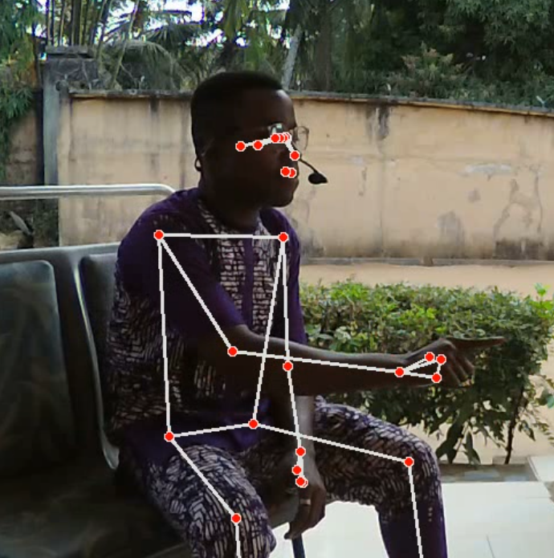
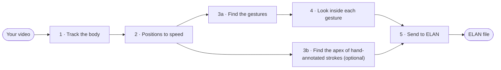

# Automatic Co-Speech Gesture Annotation

This workshop shows you how to go from a plain video of someone talking to **automatic gesture annotations that
you can open in [ELAN](https://archive.mpi.nl/tla/elan)**, without any special equipment. A free body-tracking tool
from Google (**MediaPipe**) finds the speaker's hands in every video frame. From how fast the hands move, the
notebooks find where gestures start and end, and the key moments inside them.

Everything runs on an ordinary laptop, and your videos never leave your computer. **No programming experience is
needed:** every step is explained in plain language inside the notebooks.





**Contents:** [What you need](#what-you-need) ·
[1. Download](#step-1--download-the-workshop-files) ·
[2. Install](#step-2--install-once) ·
[3. Start JupyterLab](#step-3--start-jupyterlab) ·
[4. Run the notebooks](#step-4--run-the-notebooks) ·
[5. Open the results in ELAN](#step-5--open-the-results-in-elan) ·
[Your own videos](#using-your-own-videos) ·
[Troubleshooting](#troubleshooting) ·
[Glossary](#words-youll-see)

---

## What you need

* A computer with **Windows 10 or 11**, a **Mac with an Apple chip (M1 or newer)**, or **Linux**.
  *Mac from before 2020 (Intel chip)? See [Troubleshooting](#troubleshooting).*
* About **3 GB** of free disk space.
* An internet connection for the installation. **Please install everything before the workshop**, as it
  downloads about 500 MB.
* **[ELAN](https://archive.mpi.nl/tla/elan/download)** (free), to look at the results.

---

## Step 1 · Download the workshop files

1. Go to <https://github.com/walterdych/cospeech-gesture-workshop>.
2. Click the green **Code** button, then **Download ZIP**.
3. Unzip it. On Windows: right-click the ZIP file, choose **Extract All…**, then **Extract**. On a Mac: double-click it.
4. Move the unzipped folder somewhere easy to find, such as your Documents folder.

*(Familiar with git? `git clone https://github.com/walterdych/cospeech-gesture-workshop.git` works too.)*

---

## Step 2 · Install (once)

Choose **one** of the two options. Both install exactly the same versions of everything.

* **Option A (uv)** is the simplest if you have never installed Python. It sets up everything by itself.
* **Option B (conda)** is for you if you already use Anaconda, Miniconda or Miniforge.

### Option A · uv

uv is a small, free program that installs Python and everything this workshop needs, inside the workshop folder.
It doesn't change anything else on your computer.

**A1. Open a terminal** (a window where you type commands):
* **Windows:** press the Windows key, type `PowerShell`, and press Enter.
* **Mac:** press Cmd + Space, type `Terminal`, and press Enter.

**A2. Install uv.** Copy the line for your computer, paste it into the terminal, and press Enter.

Windows:
```powershell
powershell -ExecutionPolicy ByPass -c "irm https://astral.sh/uv/install.ps1 | iex"
```

Mac or Linux:
```bash
curl -LsSf https://astral.sh/uv/install.sh | sh
```

**A3. Close the terminal and open a new one** (as in A1), so that it knows about uv.

**A4. Go to the workshop folder.** Type `cd` followed by a space. Then drag the workshop folder from your file
explorer (Windows) or Finder (Mac) into the terminal window, and press Enter.

**A5. Start the workshop:**
```bash
uv run jupyter lab
```
The first time, this downloads Python and all packages, which takes a few minutes. Then JupyterLab opens in your
web browser. **You're done installing!** Continue with [Step 3](#step-3--start-jupyterlab).

> **Next time:** open a terminal (A1), go to the folder (A4), and run `uv run jupyter lab` (A5).

### Option B · conda

**B1. Get conda.** If you already have Anaconda, Miniconda or Miniforge, skip this. Otherwise, download and install
**Miniforge** from <https://conda-forge.org/download/>, keeping all the default options.

**B2. Open a conda terminal:**
* **Windows:** open the Start menu and click **Miniforge Prompt** (or **Anaconda Prompt**).
* **Mac:** press Cmd + Space, type `Terminal`, and press Enter.

**B3. Go to the workshop folder.** On Windows, type `cd /d` followed by a space. On a Mac, type `cd` followed by a
space. Then drag the workshop folder into the terminal window and press Enter.

**B4. Create the workshop environment.** This takes a few minutes:
```bash
conda env create -f environment.yml
```

**B5. Start the workshop:**
```bash
conda activate gesture-workshop
```
```bash
jupyter lab
```
JupyterLab opens in your web browser. **You're done installing!**

> **Next time:** open a conda terminal (B2), then run `conda activate gesture-workshop` and `jupyter lab`
> (from anywhere, but it's easiest from the workshop folder, see B3).

---

## Step 3 · Start JupyterLab

JupyterLab is where you'll work. It opens in your web browser, but it runs on your own computer: nothing is uploaded.

* On the left you see the files of the workshop folder. Double-click the **`Notebook`** folder, then
  **`1_video_processing_notebook.ipynb`**.
* A notebook mixes explanations with grey **code cells**. Click a code cell and press **Shift + Enter** to run it.
  Notebook 1 explains everything you need to know about this.
* **Keep the terminal window open while you work.** Closing it stops JupyterLab. To stop properly, save your
  notebooks, close the browser tab, and press Ctrl + C in the terminal.

*Prefer VS Code? Open the workshop folder in VS Code, install its **Python** and **Jupyter** extensions, open a
notebook, click **Select Kernel** (top right), and choose `.venv` (Option A, after running `uv sync` once in the
folder) or `gesture-workshop` (Option B).*

---

## Step 4 · Run the notebooks

Run the notebooks in the `Notebook` folder in this order: **1 → 2 → 3a → 4 → 5**. Notebook **3b** is optional; it
needs strokes that you annotate by hand in ELAN (it explains how).

The workshop video, `Videos/Test_Video.MOV`, is already set up, so you can run every notebook as it is. Each one
explains what it does as it goes.

| Notebook | What it does | Makes | Time* |
|---|---|---|---|
| **1** · video processing | Finds 33 body points (wrists, fingers, elbows, ...) in every video frame with MediaPipe | `Keypoints/` | 1-3 min |
| **2** · speed align | Turns the positions into hand speeds, one value every 10 ms, smoothed | `Upsampled/` | seconds |
| **3a** · event finding | Finds the gestures automatically: stretches where the hand moves, with at least one fast moment | `Events/` | seconds |
| **3b** · apex only *(optional)* | Finds the apex of each stroke that you annotated by hand in ELAN | `Apexes/` | seconds |
| **4** · gesture annotation | Inside each gesture: finds the two biggest speed peaks and the slowest moment between them | `Gestures/` | seconds |
| **5** · annotations to ELAN | Writes everything into an ELAN file linked to the video, plus a table version | `Elan/`, `Annotations/` | seconds |

\* for the 85-second workshop video on a typical laptop

All the plots are **interactive**: drag to zoom in, double-click to zoom out, hover for exact values, and click a
legend entry to hide or show a line.

---

## Step 5 · Open the results in ELAN

1. Start ELAN and open **`Elan/Test_Video.eaf`** (*File → Open…*).
2. If ELAN says it can't find the video, choose `Videos/Test_Video.MOV`.
3. Below the video you'll see one row (**tier**) per result:
   * `gesture_id`: each gesture found, numbered 1, 2, 3, ...
   * `peaks`: the stretch between the two biggest speed peaks of each gesture
   * `min`: the slowest moment between those two peaks, a good candidate for the gesture's apex
   * `apex`: the apexes from Notebook 3b (only if you ran it)

Click an annotation to jump to it, then press play to watch the gesture.

Notebook 5 never deletes your own work: when it updates an ELAN file, it only replaces the four tiers above, and it
keeps the previous version as `Elan/<video>_backup.eaf`. **Close the file in ELAN before running Notebook 5.**

---

## Using your own videos

1. Copy your video into the **`Videos`** folder. Most formats work (`.mp4`, `.mov`, `.avi`, ...).
2. At the top of **each** notebook, in the **Settings** cell, change `VIDEO_NAME = "Test_Video"` to the name of your
   video file, without the ending. For `Videos/interview 3.mp4`, that's `VIDEO_NAME = "interview 3"`.
3. Run the notebooks in order, as above.

**Tips for good tracking:** the speaker's whole upper body is in view and well lit, there's one person in the
picture, and the camera doesn't move.

**Left-handed gestures?** In Notebook 2 add `"left_wrist"` to `KEYPOINTS`; in Notebooks 3a, 3b and 4 set
`KEYPOINT = "left_wrist"`.

**Many videos?** `Tools/batch_video_processing.ipynb` runs Notebook 1 on every video in the `Videos` folder.

### Where everything is saved

| Folder | What's in it |
|---|---|
| `Videos/` | Your videos |
| `Notebook/` | The workshop notebooks, and MediaPipe's tracking model (`pose_landmarker_full.task`) |
| `Keypoints/` | Notebook 1: position of every body point in every frame, and the video with the skeleton drawn on |
| `Upsampled/` | Notebook 2: positions, speeds and directions, every 10 ms |
| `Events/` | Notebook 3a: the same, plus which gesture each moment belongs to |
| `Apexes/` | Notebook 3b: the apexes of your hand-annotated strokes |
| `Gestures/` | Notebook 4: the same as `Events/`, plus peaks, slowest moments and changes of direction |
| `Elan/` | Notebook 5: the ELAN file |
| `Annotations/` | Notebook 5: the ELAN annotations as a table, for Excel, R or SPSS |
| `Tools/` | Extra notebooks (see below) |

All results are `.csv` tables, which open in Excel, R, SPSS, Python and most other programs.

---

## Troubleshooting

**"uv: command not found" or "'uv' is not recognized"**
Close the terminal and open a new one after installing uv (step A3).

**"conda: command not found" or "'conda' is not recognized"**
On Windows, use the **Miniforge Prompt** or **Anaconda Prompt** from the Start menu, not PowerShell.

**"No module named 'cv2'" or "No module named 'mediapipe'" on a Mac**
Your Mac has an Intel chip. MediaPipe no longer supports these, so Notebook 1 can't run on it. Everything else
still installs and works: Notebooks 2-5 use the tracking results for the workshop video that come with the files
(`Keypoints/Test_Video_keypoints.csv`). To track your own videos, run Notebook 1 on another computer and copy the
`Keypoints` file over.

**"There is no video called ... in the Videos folder"**
Check `VIDEO_NAME` in the Settings: no file ending, and the same capital and small letters as the file name.

**"Could not open ..." (a video)**
Convert the video to `.mp4`, for example with the free program [HandBrake](https://handbrake.fr), and try again.

**The person isn't found, or the skeleton is in the wrong place**
In Notebook 1, try `MODEL = "heavy"`, or lower `MIN_CONFIDENCE` to `0.3`. Check that the whole upper body is visible.

**"FileNotFoundError" in Notebooks 2-5**
The notebook before it hasn't been run yet for this `VIDEO_NAME`. Run the notebooks in order, with the same
`VIDEO_NAME` in each.

**"There is no tier called 'Stroke'" in Notebook 3b**
Follow "Before you start" at the top of Notebook 3b to add stroke annotations in ELAN.

**A plot is empty, or something behaves strangely**
Use *Kernel → Restart Kernel and Clear Outputs of All Cells…*, then run the notebook again from the top.

**My changes in ELAN are gone**
ELAN was probably still open when Notebook 5 ran. The previous version is in `Elan/<video>_backup.eaf`.

---

## The Tools folder

Extra notebooks for bigger projects. Like the main notebooks, each one explains itself and has a Settings cell.

| Notebook | What it does |
|---|---|
| `batch_video_processing` | Notebook 1 for every video in a folder, optionally several at the same time |
| `elan_tier_exporter` | Saves one tier from every ELAN file in a folder as a table |
| `annotation_extender` | Keeps only the stroke annotations in those tables and extends each by one video frame |
| `ema_data_formatting` | Adds participant, recording and task columns to a table, to combine it with other data (e.g. EMA) |
| `modified_2_speed_align_notebook_dynamic` | A variant of Notebook 2: upsamples relative to the video's frame rate, smooths more, keeps raw speed units |
| `plots` | Compares the speed of the right wrist and the right index finger |

---

## Words you'll see

| Word | Meaning |
|---|---|
| **Keypoint** | One of the 33 body points MediaPipe tracks, such as `right_wrist` or `left_index` (left index finger). "Right" and "left" are the speaker's own right and left. |
| **Frame, fps** | A video is a quick series of still pictures, called frames. *fps* (frames per second) says how many: usually 25 or 30. |
| **ms** | Millisecond: 1/1000 of a second. |
| **Interpolation, upsampling** | Estimating values between two measurements by drawing a straight line between them. Used to get a measurement every 10 ms instead of every frame. |
| **Smoothing** | Removing small, jittery wobbles from the tracking while keeping the real movements. We use a *Savitzky-Golay filter*. |
| **Velocity, speed** | Velocity: how fast and in which direction a point moves. Speed: only how fast, in any direction. |
| **Percentile** | The 70th percentile of a hand's speed is the speed that the hand is slower than 70% of the time. |
| **Peak, prominence** | A peak is a high point in the speed curve, like a hilltop. Prominence is how much it stands out from the dips around it. |
| **Gesture phases** | A gesture often has a *preparation* (the hand gets ready), a *stroke* (the meaningful, effortful part), sometimes a *hold* (the hand stays still), and a *retraction* (back to rest). |
| **Apex** | The peak moment of the stroke, where the movement "hits" its target and the hand typically brakes sharply. |
| **Tier** | A row of annotations in ELAN, such as all the gestures, or all the apexes. |
| **Notebook, cell, kernel** | A notebook is a document with explanations and runnable code *cells*. The *kernel* is the Python program that runs the cells in the background. |
---

## For maintainers

* The packages are listed in `pyproject.toml`. `uv.lock` pins their exact versions, and `requirements.txt` (used by
  `environment.yml`) is generated from it, so uv and conda users get identical versions.
* To update the packages: run `uv lock --upgrade`, then
  `uv export --no-hashes --no-dev --no-annotate -o requirements.txt`, then run all notebooks to check them.
* Before committing notebooks, clear their outputs to keep the files small:
  `uv run jupyter nbconvert --clear-output --inplace Notebook/*.ipynb Tools/*.ipynb`

## License

MIT, see [LICENSE](LICENSE).
